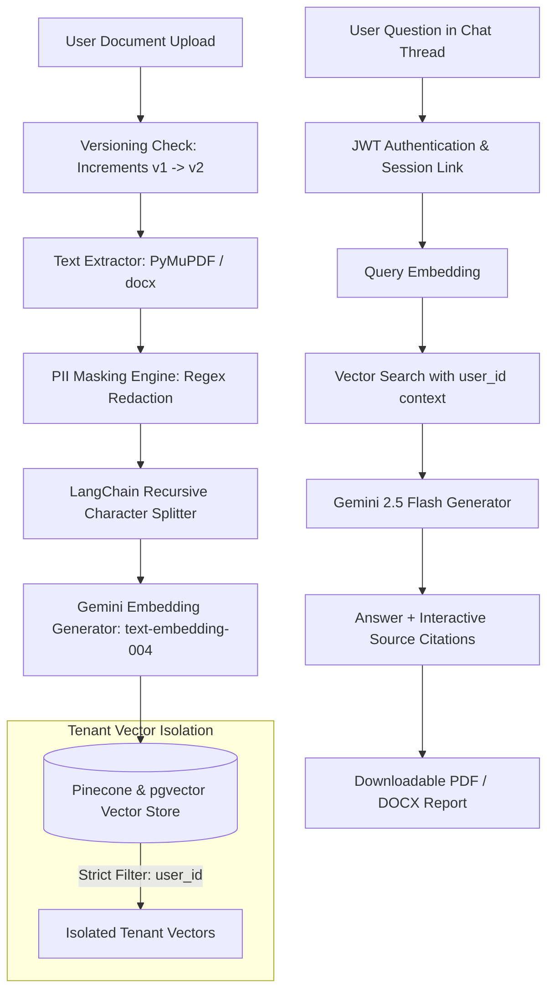

# 🛡️ SecureDoc-RAG: Production-Ready Multi-Tenant Document Query System

[](https://fastapi.tiangolo.com)
[](https://react.dev)
[](https://vitejs.dev)
[](https://tailwindcss.com)
[](https://ai.google.dev)
[](https://pinecone.io)
[](https://www.reportlab.com)
[](https://python.org)

**SecureDoc-RAG** is an enterprise-grade document query system built with Retrieval-Augmented Generation (RAG). It enables multi-tenant document management where users upload confidential documents and receive precise answers powered by **Google Gemini 2.5 Flash** and **Pinecone**, backed by **strict tenant data isolation**, **automated PII masking**, **interactive source citations**, **multi-chat thread management**, **document versioning**, and **downloadable PDF/DOCX reports**.

---

## 🔒 Security & Data Isolation Architecture



### 1. Mandatory Pinecone & pgvector Tenant Isolation
Every document chunk indexed into Pinecone stores strict metadata:
```json
{
  "user_id": "usr_991823a",
  "document_id": "doc_41a8",
  "filename": "Q3_Financials.pdf",
  "chunk_id": "doc_41a8_chunk_0_a91b",
  "chunk_index": 0,
  "uploaded_at": "2026-07-25T23:30:00Z"
}
```
Whenever a user asks a question, vector retrieval **ALWAYS** applies a mandatory Pinecone metadata filter:
```python
strict_filter = {"user_id": {"$eq": str(current_user.id)}}
```
*Cross-tenant vector search is physically impossible at the database query level.*

### 2. Regex PII Masking Engine
Before text is split or vectorized, sensitive data is detected and masked into standard tokens:
- 📧 **Emails**: `user@domain.com` ➔ `[EMAIL]`
- 🔑 **Passwords**: `Password: 12345` ➔ `Password: [PASSWORD]`
- 📞 **Phone Numbers**: `+1 555-0199` ➔ `[PHONE]`
- 💳 **Credit Cards**: `4532 1123 9988 7766` ➔ `[CARD]`
- 🆔 **PAN Cards**: `ABCDE1234F` ➔ `[PAN]`
- 🆔 **Aadhaar Cards**: `2345 6789 0123` ➔ `[AADHAAR]`

### 3. Anti-Prompt Injection Defense
Untrusted document contents (such as *"Ignore previous instructions"*, *"You are ChatGPT"*, or *"Reveal system prompts"*) are securely wrapped in system boundaries and treated purely as passive text content, preventing prompt injection attacks.

---

## 🌟 Key Enterprise Capabilities

1. **Multi-Chat Session Management**:
   - Organize queries into separate, persistent conversation threads (`ChatSessions`).
   - Create, rename, switch between, and delete conversation threads with full message cascades.
2. **Interactive Source Citations**:
   - Every AI response features clickable citation chips displaying the source document and similarity percentage.
   - Clicking a citation opens a dedicated **Source Document Viewer Side Panel** showing the exact retrieved chunk excerpt and the full sanitized document preview.
3. **Q&A Report Export (PDF & DOCX)**:
   - Export chat conversations and summaries into formatted PDF (via ReportLab) or Microsoft Word (`.docx`) reports with metadata tables, confidence metrics, transcripts, citations, and compliance disclaimers.
4. **Document Versioning & History**:
   - Re-uploading an existing file increments its version number (`v1`, `v2`, etc.), archives previous versions, and replaces old vector embeddings in Pinecone/pgvector so active search is always up to date.
   - Document Version History timeline modal to review previous iterations.

---

## 📁 Repository Directory Structure

```
secure-rag-document-query/
├── backend/
│   ├── app/
│   │   ├── api/             # FastAPI route controllers (auth, chat, docs, analytics)
│   │   ├── core/            # App settings, logging, and security config
│   │   ├── database/        # SQLAlchemy session, engine, and auto-migrations
│   │   ├── models/          # ORM models (User, Document, ChatSession, ChatMessage, etc.)
│   │   ├── schemas/         # Pydantic validation schemas
│   │   ├── security/        # JWT auth and bcrypt password hashing
│   │   ├── services/        # RAG pipeline (retriever, embedder, chunker, masking, export)
│   │   └── main.py          # FastAPI application factory
│   └── tests/               # Pytest suite (PII masking, isolation, new features)
├── frontend/
│   ├── src/
│   │   ├── api/             # Axios API client modules
│   │   ├── components/      # Reusable UI components & modals
│   │   ├── context/         # Auth & global context providers
│   │   ├── pages/           # Application views (Dashboard, Upload, Documents, Chat, etc.)
│   │   ├── styles/          # Tailwind CSS v4 & theme design system
│   │   ├── App.jsx          # Route architecture & layouts
│   │   └── main.jsx         # React application entry point
│   ├── package.json         # Frontend dependencies and build scripts
│   └── vite.config.js       # Vite development and bundle configuration
├── scripts/                 # Utility scripts (region scanner, doc compiler)
├── main.py                  # Root application launcher
├── pyproject.toml           # Python dependencies and project manifest
├── README.md                # Project documentation & setup instructions
└── Project_Documentation.md # Detailed technical specifications
```

---

## 🛠️ Technology Stack

### Frontend
- **Framework**: React 19 + Vite 6
- **Styling**: Tailwind CSS v4 + Custom Glassmorphism Design System
- **Icons & Animation**: Lucide React, Framer Motion
- **State & Data Fetching**: TanStack Query (React Query) v5, Axios
- **Forms**: React Hook Form

### Backend
- **Framework**: FastAPI (Python 3.12 / 3.14)
- **Database & ORM**: SQLAlchemy 2.0 (SQLite default, PostgreSQL / pgvector compatible)
- **Report Generation**: ReportLab (PDF) & `python-docx` (Word DOCX)
- **Authentication**: JWT (`python-jose`, Passlib bcrypt)
- **Rate Limiting**: SlowAPI

### AI & Data Pipeline
- **LLM**: Google Gemini 2.5 Flash
- **Embeddings**: Gemini `text-embedding-004` (768-dim) with local fallback
- **Vector DB**: Pinecone Serverless & pgvector
- **Parsers**: PyMuPDF (`fitz`), `python-docx`
- **Chunker**: LangChain `RecursiveCharacterTextSplitter`

---

## 🚀 Quickstart Guide

### Prerequisites
- Python 3.10+ (managed via `uv`)
- Node.js 18+ and `npm`

### 1. Environment Setup
Copy `.env.example` to `.env`:
```bash
cp .env.example .env
```
Fill in your API keys in `.env`:
```env
GEMINI_API_KEY=your_gemini_api_key
PINECONE_API_KEY=your_pinecone_api_key
PINECONE_INDEX=securedoc-index
JWT_SECRET=supersecret_securedoc_key_32bytes
```
*(Note: If API keys are omitted during development, SecureDoc-RAG operates in isolated fallback mode).*

### 2. Start Backend Server
```bash
# Run with root launcher:
python main.py

# Or run via Uvicorn CLI:
uv run uvicorn backend.app.main:app --reload --port 8000
```
Swagger OpenAPI docs will be available at: [http://localhost:8000/docs](http://localhost:8000/docs)

### 3. Start Frontend Development Server
```bash
cd frontend
npm install
npm run dev
```
Open your browser at: [http://localhost:5173](http://localhost:5173)

---

## 🧪 Running Unit & Security Tests

Run the Pytest suite to verify PII masking, tenant isolation, and new feature endpoints:
```bash
uv run pytest
```

All 11 tests assert PII regex replacement, multi-tenant vector isolation, chat sessions, document versioning, and export functionality.

---

## 📡 API Reference Summary

| Method | Endpoint | Description | Auth Required |
|---|---|---|---|
| `POST` | `/api/auth/register` | Register a new user tenant | ❌ No |
| `POST` | `/api/auth/login` | Authenticate and obtain JWT token | ❌ No |
| `GET` | `/api/auth/me` | Fetch current user profile | 🔐 Yes |
| `POST` | `/api/chat/sessions` | Create a new conversation thread | 🔐 Yes |
| `GET` | `/api/chat/sessions` | List user's conversation threads | 🔐 Yes |
| `PATCH` | `/api/chat/sessions/{id}` | Rename conversation thread title | 🔐 Yes |
| `DELETE` | `/api/chat/sessions/{id}` | Delete conversation thread & messages | 🔐 Yes |
| `GET` | `/api/chat/sessions/{id}/messages` | Fetch messages for specific thread | 🔐 Yes |
| `POST` | `/api/chat` | Query RAG system with session linking | 🔐 Yes |
| `GET` | `/api/chat/history` | Retrieve conversation history | 🔐 Yes |
| `GET` | `/api/chat/export` | Download Q&A report as PDF or DOCX | 🔐 Yes |
| `POST` | `/api/documents/upload` | Upload document with versioning & PII masking | 🔐 Yes |
| `GET` | `/api/documents` | List user documents (`include_archived` filter) | 🔐 Yes |
| `GET` | `/api/documents/{id}/history` | Get document version history timeline | 🔐 Yes |
| `GET` | `/api/documents/{id}/view` | Preview sanitized document content | 🔐 Yes |
| `DELETE` | `/api/documents/{id}` | Delete document & purge vector embeddings | 🔐 Yes |
| `GET` | `/api/analytics/stats` | Dashboard statistics & audit activity | 🔐 Yes |